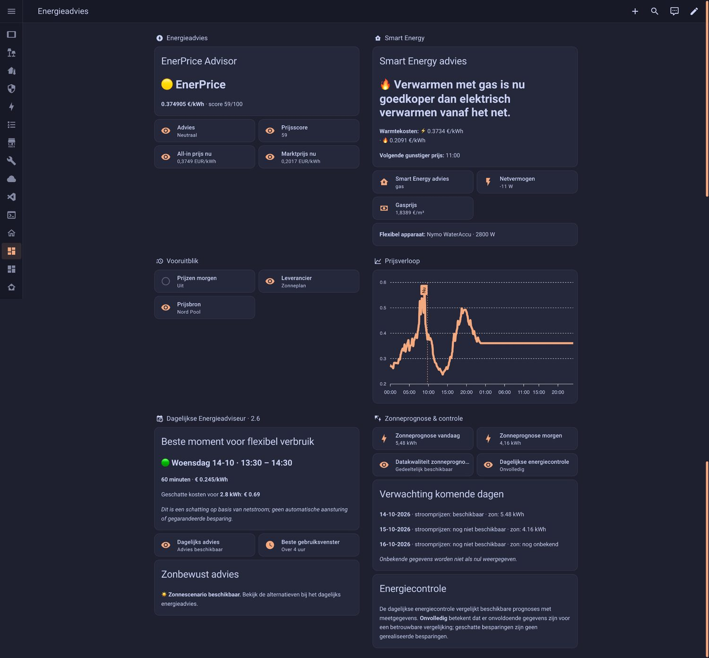
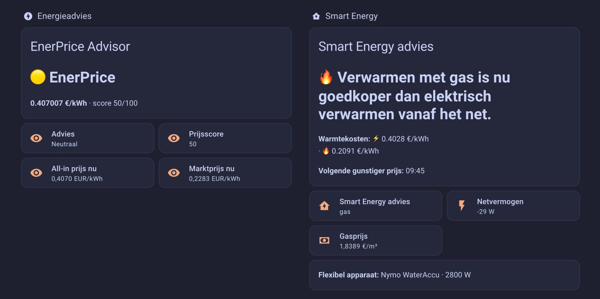
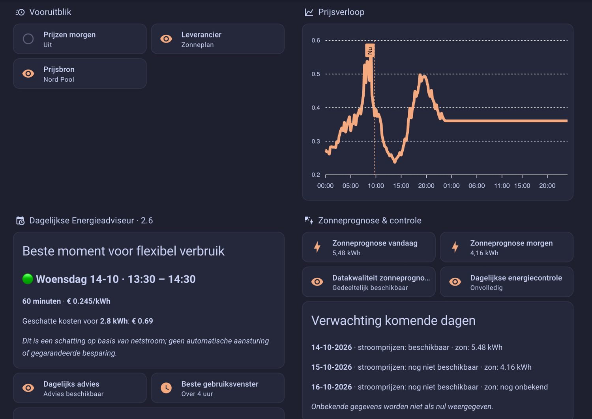
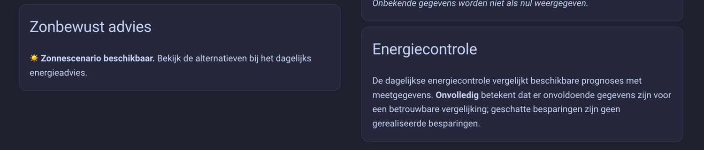

# EnerPrice 2.6 — Wat is nieuw en hoe gebruik je het?

**Taal:** [English](enerprice-v2-6-user-guide.md) | Nederlands

EnerPrice 2.6 voegt de **Dagelijkse Energieadviseur** toe. Deze functie is optioneel: bestaande prijzen, sensoren en automatiseringen blijven werken. EnerPrice adviseert; het schakelt zelf geen apparaten in of uit.

## In vijf stappen beginnen

1. Werk EnerPrice via **HACS** bij en herstart Home Assistant.
2. Open **Instellingen → Apparaten & diensten → EnerPrice → Configureren** en schakel de **Dagelijkse Energieadviseur** in.
3. Stel het **vermogen van je flexibele apparaat** in (in watt) en de gewenste **gebruiksduur** (in minuten). Voorbeeld: een apparaat van 2.800 W dat één uur draait gebruikt ongeveer 2,8 kWh.
4. Controleer de entiteit **Dagelijks energieadvies**. Het standaardadvies zoekt de goedkoopste aaneengesloten periode op basis van gepubliceerde all-in stroomprijzen. De start- en eindtijd volgen de Nederlandse marktklok.
5. Wil je zon meenemen? Selecteer je Forecast.Solar-voorspellingen en de actuele P1/netvermogens- en zonneproductiesensor. Zie hieronder welke gegevens nodig zijn.

**Je hoeft niet alle opties in te vullen.** Zonder zonnesensoren blijft het gewone prijsadvies werken. Zonder gepubliceerde prijzen voor morgen verzint EnerPrice geen advies voor morgen.

## Wat zie je in het dagelijkse advies?

- **Beste verbruiksperiode (netstroom)**: goedkoopste volledig geprijsde venster, met geschatte kosten voor het ingestelde apparaat. `grid_only` betekent dat zonneproductie niet is afgetrokken.
- **Zonnescenario**: een *aparte, voorwaardelijke vergelijking* die de verwachte zon, een geschat huishoudelijk basisverbruik en eventuele gemiste terugleveropbrengst meeneemt. Dit is geen garantie dat die hoeveelheid zonnestroom beschikbaar zal zijn.
- **Vandaag/morgen**: dagoverzicht met prijsstatus en verwachte zonne-energie. `unknown` betekent dat er nog geen bruikbare prijs is gepubliceerd; niet dat de prijs nul is.
- **Grafiek**: kwartierprijzen en verwachte zonneproductie waar beschikbaar.
- **Potentieel voordeel**: modelvergelijking, **geen gerealiseerde besparing**.

## Zonneadvies instellen

Gebruik in de EnerPrice-opties:
- **Forecast.Solar**: voorspelde zonneproductie voor vandaag en morgen (en de onderliggende tijdreeks).
- **P1/netvermogen**: een sensor in **W**; positief = stroom afnemen, negatief = terugleveren.
- **Actuele zonneproductie**: een sensor in **W**. Bij meerdere omvormers kun je de vermogens via een Home Assistant-templatesensor optellen.
- **Flexibel apparaat**: het nominale vermogen in **W** en de gewenste gebruiksduur.

EnerPrice schat het huidige huishoudelijke basisverbruik uit **zonnevermogen + netvermogen**. Beide metingen moeten recent genoeg zijn en bij elkaar passen. In 2.6.2 wordt een gecontroleerd venster van maximaal **vijf minuten** gebruikt: beide metingen mogen hoogstens vijf minuten oud zijn en hoogstens vijf minuten uit elkaar liggen. Verouderde metingen worden niet stilzwijgend als actueel gebruikt.

Voor een economisch zonnescenario zijn ook bruikbare **terugleverprijzen** voor de betreffende intervallen nodig. Ontbreekt een noodzakelijke invoer, dan blijft het normale netstroomadvies beschikbaar en meldt EnerPrice waarom het zonnescenario ontbreekt.

### Zonnediagnose begrijpen

Bekijk in **Ontwikkelaarstools → Statussen** de attributen van de entiteit *Dagelijks energieadvies*:
- `solar_scenario_available: true`: er is een voorwaardelijk zonnescenario berekend.
- `solar_scenario_available: false`: er is momenteel geen bruikbaar zonnescenario.
- `solar_diagnostics: power_measurements_not_synchronized`: de actuele P1- en zonnevermogensmetingen zijn te ver uit elkaar, te oud of anderszins ongeschikt voor een betrouwbare basislast.
- `solar_forecast_series_unavailable`: geen bruikbare tijdreeks voor de zon.
- `export_price_missing`: benodigde terugleverprijzen ontbreken.
- `solar_forecast_interval_incomplete`: de voorspelling dekt niet alle benodigde intervallen.
- `no_eligible_solar_window`: er is geen geschikt zonnevenster gevonden.
- `flexible_load_power_missing`: stel het vermogen van het apparaat in.

De `best_window` blijft bewust `grid_only`. Kijk in `advice` naar een afzonderlijke optie met `model: solar_scenario`.

## Optionele ochtendmelding

Je kunt een dagelijkse briefing naar een gekozen Home Assistant-meldingsdoel laten sturen:
1. Zet dagelijkse meldingen aan.
2. Kies het gewenste meldingsdoel (bijvoorbeeld de mobiele Home Assistant-app) en een lokale tijd.
3. Geef **expliciet toestemming** voor dat doel en sla op.

Een voorkeur inschakelen is op zichzelf geen toestemming. De melding bevat het beschikbare advies; een bezorgpoging is maximaal eenmaal per dag en een geslaagde Home Assistant-serviceaanroep garandeert niet dat je telefoon de melding heeft getoond.

## Voorspelling versus werkelijkheid

Voor de optionele energieprestatiecontrole zijn **cumulatieve**, niet dagelijks terugzettende kWh/Wh-meters voor netafname en teruglevering nodig, plus een cumulatieve zonne-energiemeter. EnerPrice vergelijkt alleen gegevens wanneer metingen en daggrenzen voldoende compleet en betrouwbaar zijn. Ontbrekende gegevens blijven onbekend. De functie bewijst geen daadwerkelijke financiële besparing.

## Dashboardvoorbeelden

Onderstaande schermafbeeldingen komen uit een bestaande Home Assistant-installatie. Entiteitsnamen, leveranciersprijzen, apparaatinstellingen en meetwaarden verschillen per gebruiker. Dit is een zelf ingericht Home Assistant Sections-dashboard; EnerPrice installeert dit dashboard niet automatisch.

### Compleet dashboard

### Prijsadvies en Smart Energy

### Prijsgrafiek en Dagelijkse Energieadviseur

### Zonbewust advies

Het netstroomadvies en het voorwaardelijke zonnescenario zijn afzonderlijk. Verwachte voordelen zijn geen bewezen besparingen. De screenshots zijn voorbeelden, geen standaard-entiteitsnamen of gegarandeerde uitkomsten.

## Dashboard en gebruiksgemak

Genereer een dashboard via `nl_day_ahead_prices.generate_dashboard_yaml` met `include_daily_advisor: true`. Zonder ApexCharts kun je `use_apexcharts: false` gebruiken. Bestaande dashboards worden **niet automatisch overschreven**.

**Aanbevolen opbouw:** begin met alleen prijzen en het netstroomadvies; voeg daarna zon toe, vervolgens eventueel meldingen en als laatste prestatiecontrole. Zo hoef je niet alle geavanceerde opties tegelijk in te stellen.

## Grenzen en veiligheid

- Adviezen zijn schattingen, geen automatische schakelingen of garanties.
- Alleen daadwerkelijk gepubliceerde prijsintervallen worden gebruikt.
- Gemiste terugleveropbrengst telt mee in het afzonderlijke zonnescenario, maar niet in het bestaande warmteadvies.
- Entiteitsnamen kunnen per Home Assistant-installatie verschillen.
- Bij twijfel: controleer eerst de entiteitsstatussen en de diagnosevelden voordat je automatiseringen op adviezen baseert.
