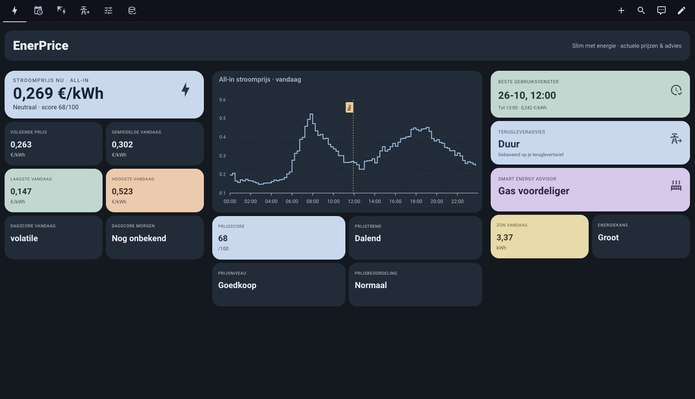
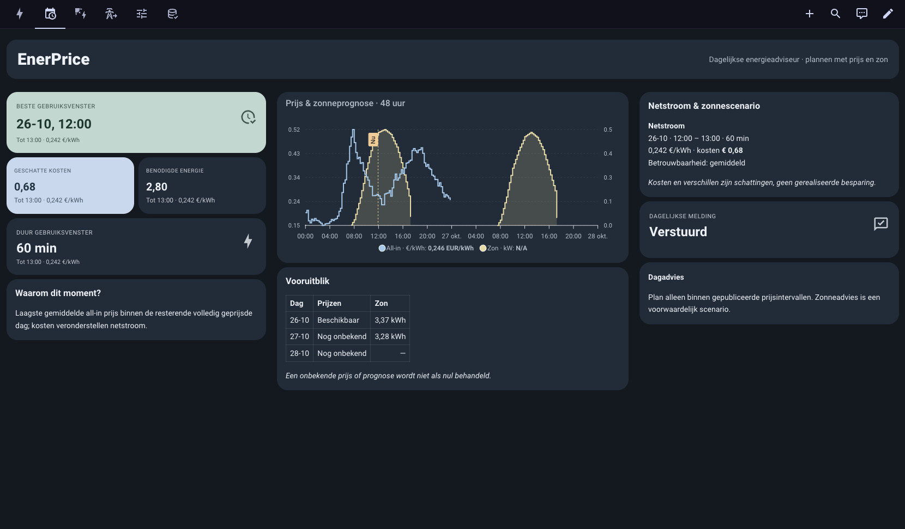
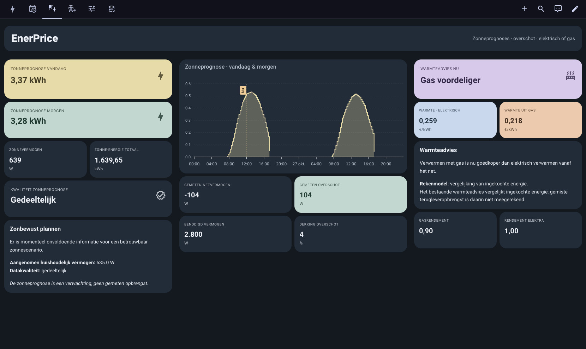
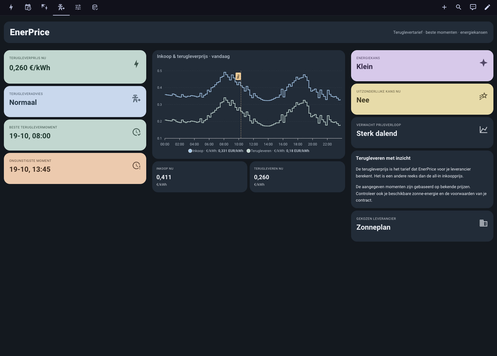
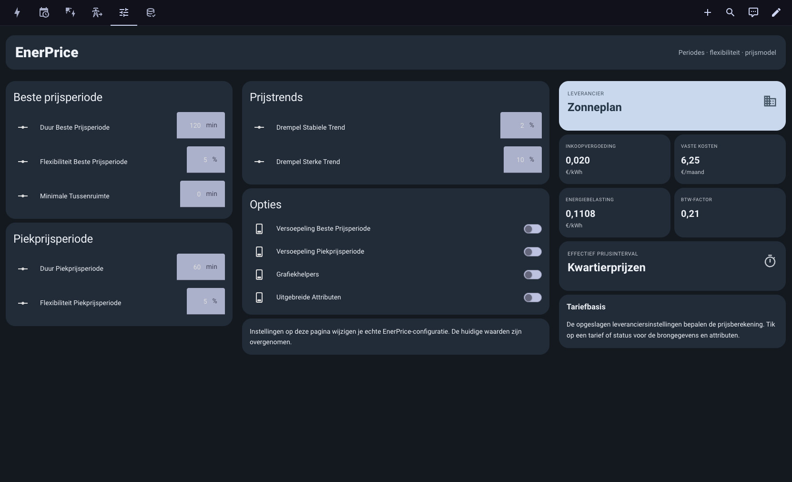
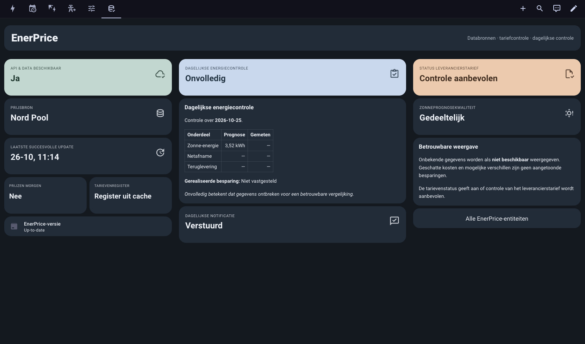

# EnerPrice 2.6 — What's new and how to use it

**Language:** English | [Nederlands](enerprice-v2-6-gebruikershandleiding.md)

EnerPrice 2.6 introduces the optional **Daily Energy Advisor**. Existing prices, entities and automations continue to work. EnerPrice provides advice; it **does not automatically switch devices**.

## Get started in five steps

1. Update EnerPrice in **HACS** and restart Home Assistant.
2. Open **Settings → Devices & services → EnerPrice → Configure** and enable **Daily Energy Advisor**.
3. Enter your **flexible appliance power** in watts and its **runtime** in minutes. For example, a 2,800 W appliance running for one hour consumes approximately 2.8 kWh.
4. Inspect the **Daily Energy Advice** entity. The default recommendation identifies the cheapest consecutive period using published all-in electricity prices. Energy-market dates and windows use the Europe/Amsterdam timezone.
5. Want solar-aware advice? Configure Forecast.Solar and your current P1/grid and solar-production power entities, as described below.

**You do not need to configure everything.** The regular electricity-price recommendation still works without solar sensors. If tomorrow's prices have not been published, EnerPrice does not invent them.

## Understanding the daily recommendation

- **Best consumption window (grid-only):** the cheapest fully priced period, with estimated appliance cost. `grid_only` means solar generation has not been deducted.
- **Solar scenario:** a *separate, conditional estimate* considering forecast generation, assumed household demand and the opportunity cost of electricity that could otherwise be exported. It is not a guarantee of available solar surplus.
- **Today and tomorrow:** daily price availability and predicted solar energy. `unknown` means no usable published price, not a zero price.
- **Chart:** available electricity price intervals and forecast solar generation.
- **Potential financial impact:** a model-based comparison, **not verified savings**.

## Configure solar-aware advice

Select the following inputs in EnerPrice options:

- **Forecast.Solar:** predicted solar generation for today and tomorrow, including the underlying forecast time series.
- **P1/grid power:** a sensor in **W**, where positive means grid import and negative means export.
- **Current solar production:** a sensor in **W**. If you have several inverters, combine their power readings with a Home Assistant template sensor.
- **Flexible appliance:** its nominal power in **W** and required runtime.

EnerPrice estimates current household baseline load as **solar power + grid power**. Both readings must be recent and sufficiently synchronized. The planned 2.6.2 improvement accepts readings up to **five minutes apart**, provided **both readings are no more than five minutes old**. Older measurements are never silently treated as live readings.

A financially meaningful solar scenario also needs usable **export prices** for the relevant intervals. When required data is missing, the normal grid-only recommendation remains available and the solar diagnostics explain what is missing.

### Troubleshoot solar scenarios

Go to **Developer tools → States** and inspect the attributes of the *Daily Energy Advice* entity:

- `solar_scenario_available: true`: a conditional solar scenario was calculated.
- `solar_scenario_available: false`: no usable solar scenario is currently available.
- `power_measurements_not_synchronized`: grid and solar power measurements are too far apart, too old or otherwise unsuitable for estimating baseline demand.
- `solar_forecast_series_unavailable`: no usable solar forecast time series.
- `export_price_missing`: required export prices are missing.
- `solar_forecast_interval_incomplete`: solar forecast coverage is incomplete.
- `no_eligible_solar_window`: no suitable solar window was found.
- `flexible_load_power_missing`: configure the appliance power.

The primary `best_window` deliberately remains `grid_only`. Look in `advice` for a separate entry with `model: solar_scenario`.

## Optional morning notification

To receive a daily Home Assistant briefing:

1. Enable daily notifications.
2. Choose a supported notification target, such as your Home Assistant mobile app, and a local delivery time.
3. Give **explicit consent** for that target and save.

Enabling a preference alone does not grant consent. Delivery is attempted at most once per day. A successful Home Assistant notification service call does not prove that the message appeared on your phone.

## Forecast versus actual energy

Optional energy performance tracking requires **cumulative** import and export energy counters in Wh/kWh, plus a cumulative solar energy counter. Do **not** use daily-reset meters. EnerPrice compares predictions with actual energy only when readings and day boundaries are complete and reliable. Missing evidence stays unknown; the feature does not establish realized financial savings.

## Dashboard examples

These screenshots show six tabs of a real Home Assistant Sections dashboard, captured on 26 October 2026. Sensor names, tariffs, settings, and values vary by installation. EnerPrice does not automatically install this custom dashboard.

### Overview: electricity prices and advice

### Daily Energy Advisor

### Solar-aware planning

### Export tariff and energy opportunities

### Settings and price model

### Data sources and diagnostics

The grid-only recommendation and conditional solar scenario are separate; forecast savings are not verified realized savings. These screenshots illustrate one configuration, not default entity IDs or guaranteed results.

## Dashboards and a simple setup path

Generate dashboard YAML with `nl_day_ahead_prices.generate_dashboard_yaml` and `include_daily_advisor: true`. Use `use_apexcharts: false` for a dashboard based on built-in Home Assistant cards. Existing dashboards are **not overwritten automatically**.

**Recommended setup order:** start with electricity prices and the grid-only recommendation; add solar forecasting next, then notifications if desired, and finally performance tracking. You do not need to configure every advanced option at once.

## Limitations and safety

- Recommendations are estimates, not automatic switching actions or guarantees.
- Only actually published electricity price intervals are used.
- Foregone export revenue is considered in the separate solar scenario, not in the existing heat-source advice.
- Entity names can differ between Home Assistant installations.
- Check entity states and diagnostics before using recommendations in your own automations.
